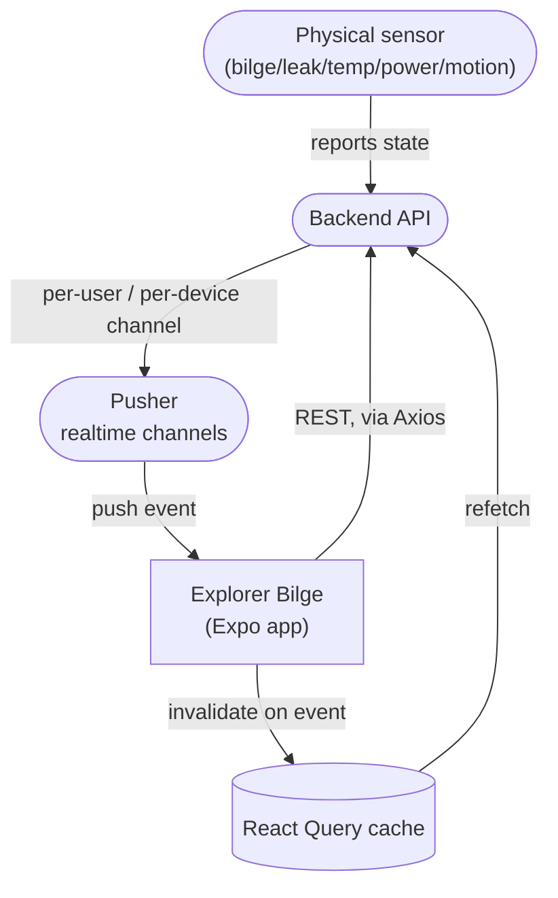

# Explorer Bilge

**A React Native companion app for monitoring marine/boat IoT sensors in real time.** Explorer Bilge pairs with a fleet of hardware sensors — bilge water level, leak detection, generator status, temperature/humidity, battery, power-loss, and motion — installed aboard a boat or at a storage site, and gives the owner a live dashboard, push-driven alerts, and a two-way calling channel back to the monitoring device, all from their phone.

       

---

### Contents

[What this is](#what-this-is) · [At a glance](#at-a-glance) · [Architecture](#architecture) · [Realtime alerts](#realtime-alerts--live-dashboard) · [Two-way calling](#two-way-calling) · [Device model](#device-model--customizable-dashboard) · [Offline handling](#offline-handling) · [Project structure](#project-structure) · [Getting started](#getting-started)

## What this is

A customer activates a physical sensor device (via an activation code tied to the device's serial/product line) and assigns it a name and location — a boat, a storage unit, a building. From then on, that device reports its state (bilge/water level, temperature, humidity, battery, motion, power) to a backend over its own hardware connection, and this app is the owner's window into it: a live dashboard, historical event timelines, configurable alert rules per device, scheduled health checks, and — when something needs a human on the other end — a direct two-way voice/video call to whoever is near the monitored device.

This is a real, shipped product, not a demo. The repository here has been renamed and genericized for private portfolio tracking — client-specific domains, bundle identifiers, and API tokens have been removed from this README (though the working app itself, in this private repo, still targets its real backend).

## At a glance

| | |
|---|---|
| **Platform** | Expo (React Native 0.81, New Architecture enabled), iOS + Android |
| **Navigation** | Expo Router v6, file-based, typed routes |
| **State** | Zustand — separate stores for auth, alarms, calls, add-device flow, network status, and the Pusher connection itself |
| **Server state** | TanStack React Query, cache invalidated by realtime push rather than polling |
| **Realtime** | Pusher — per-user and per-device channels drive both live sensor data and incoming-call signaling |
| **Calling** | A dedicated incoming/outgoing call flow (ringing UI, accept/reject, in-call overlay) layered over Pusher signaling |
| **Styling** | NativeWind (Tailwind for React Native) |
| **Billing** | Stripe React Native SDK, tied to device activation/subscription |
| **Offline** | A dedicated network store + banner; API calls short-circuit with a distinct "offline" error shape instead of a generic failure |

## Architecture



The app never polls for live state. A Pusher event on the relevant channel invalidates the matching React Query key, which triggers a normal refetch through the existing Axios/REST layer — so the "live" dashboard is really a push-triggered refresh of the same data path used everywhere else, not a second, parallel realtime data model to keep in sync.

Pusher connection lifecycle is tied to `AppState`: the app disconnects when backgrounded and reconnects fresh when foregrounded, rather than holding a socket open indefinitely or trusting a backgrounded socket's state once the app returns.

## Realtime alerts & live dashboard

Each monitored device exposes a dashboard of reorderable tiles (temperature, humidity, bilge/water level, battery, power, motion, a 24-hour alert count) built with `react-native-draggable-flatlist`; the user's chosen tile order persists locally per device. A background weather and tide lookup (nearest-station distance computed client-side) sits alongside the sensor tiles for boats with a location. Device-specific alert rules and health-check schedules are configurable per device, separate from the dashboard itself — "what should raise an alert" is a per-device setting, not a global one.

## Two-way calling

Incoming calls arrive as a Pusher event on a per-user channel; the app surfaces a native-feeling incoming-call screen (ringing state, accept/reject) and, once accepted, an in-call overlay — independent of whatever screen the user was on when the call came in. This is the mechanism for a monitored site to reach the device owner directly (e.g. a dockmaster or on-site contact), not a generic chat feature.

## Device model & customizable dashboard

Adding a device is its own guided flow (`store/addDeviceStore.ts`) — activation code entry and verification, naming, location assignment, photo — kept as a separate store from the dashboard's own state so an in-progress "add device" form survives navigation without polluting the dashboard's query cache. Device configuration (notification rules, health-check schedules) lives under its own settings surface per device, with its own modal/list components, rather than overloading the add-device form.

## Offline handling

A dedicated network store initializes a `NetInfo` listener once at the app root. API calls go through a shared Axios wrapper (`api/apiHelper.ts`) that distinguishes an offline failure (`isOffline: true`) from a real server error, so the UI can show "No internet connection" instead of a misleading generic error message when the device itself is the problem, not the backend.

## Project structure

```
app/(auth)/              Login, registration, password reset, device activation
app/(tabs)/              Dashboard, devices, events, call, alerts config, settings
api/                     Axios instance + a thin get/post wrapper with offline detection
components/dashboard/    Dashboard header, skeleton loading state, weather + monitoring sections
components/devices/      Per-device charts, settings modal, event detail modal
components/Events/       Event history list + columns
hooks/                   usePusher (connection + event subscription), useDashboard,
                          useIncomingCall, useWeather, useNetwork, usePushToken
store/                   Zustand stores — auth, alarms, calls, add-device, network, pusher
services/                REST calls per domain (auth, devices, user-devices, settings, weather)
constants/                Pusher channel/event names, device packet message catalog, storage keys
types/                   Shared TypeScript types per domain
```

## Getting started

```bash
npm install
npx expo start
```

Requires a `.env` with the backend API base URL, Pusher app key/cluster, and Stripe publishable key (not included in this repo).

---

*A real production app, privately renamed for portfolio tracking — identifying client details are intentionally omitted from this README.*
